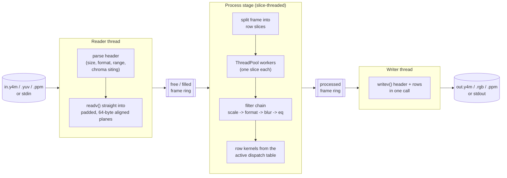
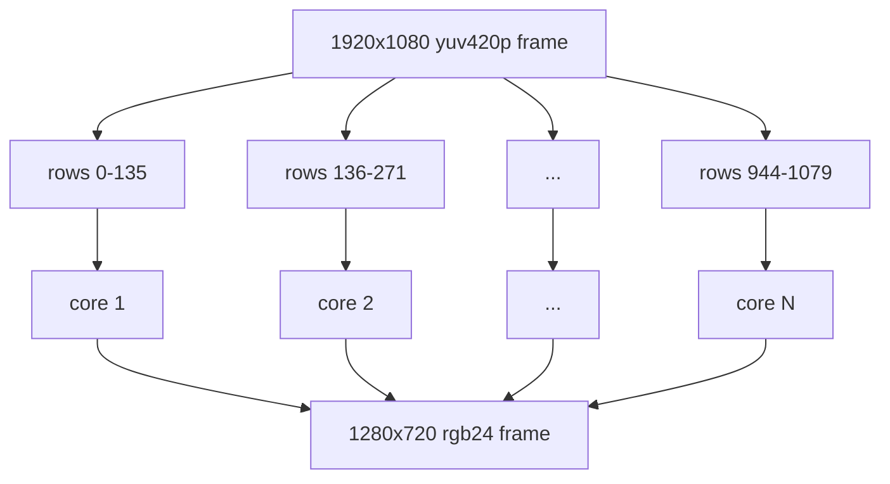
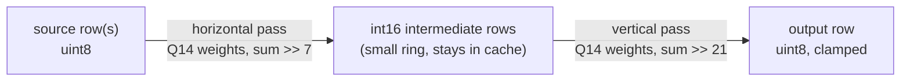
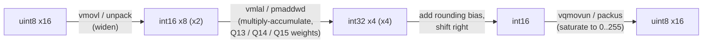
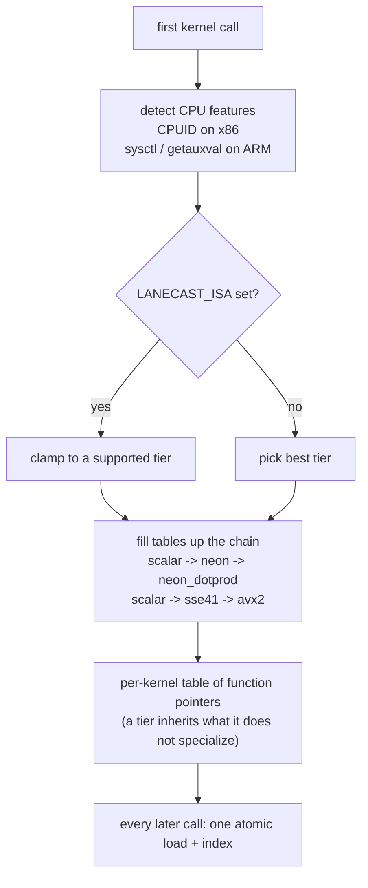

# lanecast

A portable C++20, SIMD-first raw video toolkit inspired by FFmpeg: pixel
format conversion, scaling, filters, quality metrics, Y4M/PPM IO and a
slice-threaded CLI pipeline. Hand-written NEON, SSE4.1 and AVX2 kernels with
runtime dispatch, each bit-exact against a scalar reference. The goal is to
beat libswscale and libavfilter on every op lanecast implements, at equal or
better quality.

```sh
cmake -B build && cmake --build build -j && ctest --test-dir build --output-on-failure
./build/tools/lanecast -i in.y4m -vf "scale=1280:720,format=rgb24" -o out.rgb
```

`LANECAST_ISA=scalar|neon|neon_dotprod|neon_i8mm|sse41|avx2` forces an ISA tier.
Design details live in [ARCHITECTURE.md](ARCHITECTURE.md).

## Data flow

Three stages run at once on every frame stream: while frame N is processed,
frame N+1 is being read and frame N-1 is being written. Frames live in a small
ring that is allocated once, so nothing allocates per frame.



Inside the process stage every filter works on a range of rows, so the thread
pool can hand each core its own horizontal strip. Kernels only ever write the
rows they own, which keeps slices independent.



### Scaling: two separable passes



Filter tables are built once with integer math (swscale-equivalent bilinear
that widens on downscale, and area). Each output pixel is a short dot product
of source pixels and weights, which is exactly what SIMD multiply-accumulate
instructions are built for.

## SIMD principles used here

### 1. Lanes: one instruction, many pixels

A 128-bit NEON or SSE register holds 16 bytes, so one instruction touches 16
pixels of a plane at once. AVX2 doubles that to 32.

```
register  | p0 | p1 | p2 | p3 | p4 | p5 | p6 | p7 | p8 | p9 | pA | pB | pC | pD | pE | pF |   16 x uint8
          +----+----+----+----+----+----+----+----+----+----+----+----+----+----+----+----+
op        |                      one vqaddq_u8 / _mm_adds_epu8                             |
```

### 2. Deinterleave on load

Packed RGB stores pixels as `R G B R G B ...`. NEON's `vld3q_u8` and `vld4q_u8`
split that into one register per channel in a single load, so the math runs on
whole planes of R, G and B. x86 gets the same result with `pshufb` shuffles.

```
memory    R0 G0 B0 R1 G1 B1 R2 G2 B2 ...
            \  |  /
vld3q_u8    R: R0 R1 R2 ... R15
            G: G0 G1 G2 ... G15
            B: B0 B1 B2 ... B15
```

### 3. Widen, multiply-accumulate, narrow

8-bit pixels times color or filter weights overflow 8 bits, so kernels widen
to 16 or 32 bits, multiply-accumulate in fixed point, then round, shift and
saturate back to 8 bits.



### 4. Fixed point, bit-exact on every CPU

No floats in the pixel path. Every kernel follows an integer formula written
in its public header (for example `R = clamp8((cy*(Y-yoff) + crv*(V-128) + 4096) >> 13)`),
so the scalar, NEON, SSE4.1 and AVX2 versions produce identical bytes. The
tests run each kernel under every ISA the machine supports and compare
against scalar.

### 5. Padding instead of scalar tails

Every row has at least 64 spare bytes after it. A kernel finishes a row with
one more full vector instead of a slow scalar loop for the last few pixels.
Tests fill the padding with random bytes to prove no result depends on it.

```
row       | visible pixels ......................... | padding (>= 64 B) |
vectors   [ 16 ][ 16 ][ 16 ] ... [ 16 ][ 16 ][ last full 16 ]
                                               ^ may run into padding, never past it
```

### 6. Runtime dispatch

One binary runs on any CPU of its architecture. Each ISA lives in its own
translation unit compiled with its own flags (`-msse4.1`, `-mavx2`,
`+dotprod`), and the best table is picked once at startup.



### 7. Threads on top of SIMD

SIMD makes one core fast, slices put every core to work, and the reader and
writer threads hide disk and pipe time behind the math.

## License

MIT
